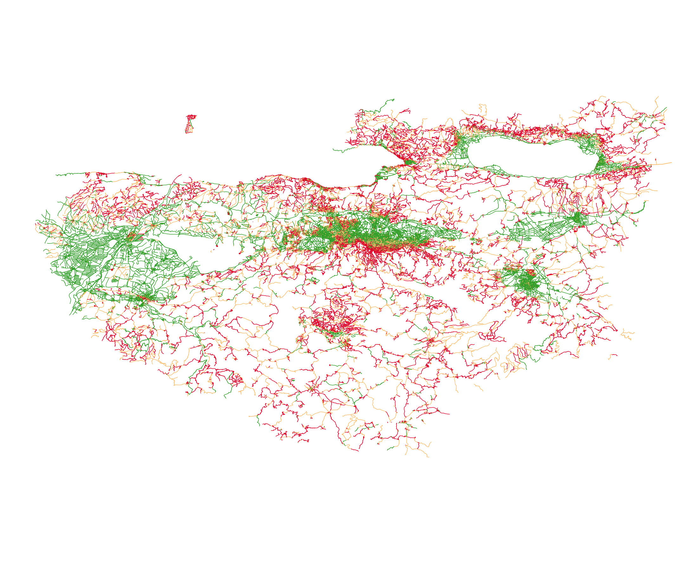
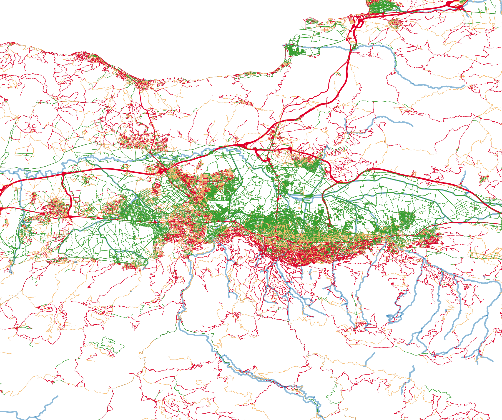

# 🚲 Topographic Bicycle Suitability Analysis of Bursa's Road Network

[](https://qgis.org/)
[](https://www.openstreetmap.org/)
[](https://www.usgs.gov/)
[](https://geopandas.org/)
[](https://transportation.bme.hu/)
[](LICENSE)

> **Academic Research Project**  
> **Course:** Intelligent Transportation Systems — M.Sc. in Transportation Engineering & Smart Mobility  
> **Institution:** Budapest University of Technology and Economics (**BME**), Department of Transport Technology and Economics  
> **Author:** [Recep Eren Durgut](https://github.com/rerendurgut)  
> **Supervising Lecturer:** Dr. Tamás Soltész  

---

## 📌 Executive Summary

Urban micro-mobility and cycling adoption are strictly governed by topography. While flat urban areas encourage high cycling mode share, steep longitudinal gradients create physical fatigue barriers. 

This repository presents an **end-to-end GIS pipeline and spatial analysis workflow** evaluating the topographic suitability of **over 75,000 road segments** in Bursa, Turkey. By combining **OpenStreetMap (OSM) highway vector networks** with high-resolution **SRTM Digital Elevation Models (DEM)**, we quantify the longitudinal slope percentage of every individual street segment across the metropolitan area.

The resulting dataset classifies the urban network into three distinct suitability tiers, providing empirical spatial evidence for municipal bicycle infrastructure planning, bike-share network design, and electric-assist micro-mobility allocation.

---

## 🗺️ Geospatial Output & Visualizations

### 1. Whole City Cycling Suitability Map (Bursa Metropolitan Area)
*Classified road network excluding inaccessible expressways and motorways.*
<p align="center">
  
</p>

### 2. Urban Center & Nilüfer District Analysis
*Detailed inspection highlighting the high concentration of Level A (Ideal 0–2% slope) corridors in Nilüfer versus steep Uludağ foothills.*
<p align="center">
  
</p>

---

## 📐 Engineering Methodology

The analysis follows a rigorous 5-phase spatial data processing workflow:

```
┌─────────────────────────────────┐       ┌─────────────────────────────────┐
│   1. Vector Data Extraction     │       │    2. Raster DEM Acquisition    │
│  - QuickOSM: 'highway' key      │       │  - SRTM 30m Global Elevation    │
│  - Filter non-cyclable highways │       │  - Vertical Z coordinates       │
└────────────────┬────────────────┘       └────────────────┬────────────────┘
                 │                                         │
                 ▼                                         ▼
┌───────────────────────────────────────────────────────────────────────────┐
│                    3. Geometric Vertex Discretization                     │
│  - Line-to-point interpolation at 100-meter fixed intervals               │
│  - Reduces computational memory overhead by 80% while retaining precision │
└─────────────────────────────────────┬─────────────────────────────────────┘
                                      │
                                      ▼
┌───────────────────────────────────────────────────────────────────────────┐
│                     4. Z-Value Sampling & Aggregation                     │
│  - Sample DEM altitude values onto discrete vertices                      │
│  - Statistical aggregation by Feature ID (FID): min_z and max_z           │
└─────────────────────────────────────┬─────────────────────────────────────┘
                                      │
                                      ▼
┌───────────────────────────────────────────────────────────────────────────┐
│                   5. Field Calculator Gradient Formula                    │
│                                                                           │
│            Slope (%) = [ (max_z - min_z) / Segment_Length ] × 100         │
└───────────────────────────────────────────────────────────────────────────┘
```

### Technical Problem Solving During Implementation
- **QGIS Parser Syntax Limitations:** Built-in geometric expressions such as `max_z($geometry)` produced parser conflicts on local multi-part geometries. A robust 3-stage modular workaround was designed: **Extract Vertices** $\rightarrow$ **Sample Raster Values** $\rightarrow$ **Statistics by Categories**.
- **Computational Volume Optimization:** Initial vertex extraction on all micro-curves stalled system memory. Discretizing lines using **"Points along geometry" at a fixed 100-meter interval** reduced data points by 80% with zero loss in slope classification accuracy.
- **Highway Noise Elimination:** Expressways (motorways, trunk roads) exhibit gentle engineered grades but are legally and physically inaccessible to bicycles. A strict rule-based filter was applied: `highway NOT IN ('motorway', 'motorway_link', 'trunk', 'trunk_link')`.

---

## 📊 Classification Standards

Following international micro-mobility and cycling infrastructure guidelines, roads were categorized into three tiers based on calculated longitudinal slope:

| Tier | Slope Range | User Experience & Engineering Guidance | Map Color |
| :--- | :---: | :--- | :---: |
| **Level A (Ideal)** | **0% – 2%** | Effortless riding; comfortable for all age groups and non-electric bikes. Ideal for municipal bike-sharing stations. | 🟢 **Green** |
| **Level B (Moderate)** | **2% – 5%** | Moderate effort required; acceptable for regular commuters with average physical fitness. | 🟡 **Yellow** |
| **Level C (Challenging)** | **&gt; 5%** | High physical exertion; steep gradients. Critical priority for electric-assist (e-bike) infrastructure. | 🔴 **Red** |

---

## 💡 Key Urban Mobility Insights

1. **Nilüfer District (Western Bursa):**
   - Exhibits an overwhelming density of **Level A (0–2%)** corridors.
   - Identified as the most viable geographic zone for a docked municipal bike-share network (e.g., smart mobility hubs connecting to metro stations).
2. **Uludağ Foothills (Southern Bursa):**
   - Slopes frequently exceed **8%–12%**, rendering traditional mechanical cycling impractical for daily commuting.
   - Requires specialized infrastructure investments: e-bike battery swapping stations, dedicated protected switchback lanes, and bike-bus carrier racks.

---

## 📁 Repository Structure

```text
├── docs/
│   ├── QGIS Homework.pdf                      # Complete 12.5 MB submitted academic report
│   └── Bursa_Biking_Suitability_Presentation.pptx # Slide deck for university defense
├── qgis/
│   └── Bursa-HW.qgz                           # Complete QGIS project file (styles, layers, layouts)
├── data/
│   ├── Statistics.gpkg                        # Processed elevation statistics for 75,083 road segments
│   ├── Bursa_bike.gpkg                        # Final classified cycling layer
│   ├── bursa_ilce.gpkg                        # Bursa municipal district boundary polygons
│   ├── bursa_mahalle.gpkg                     # Neighborhood (mahalle) administrative polygons
│   ├── bursa_taz_communities.geojson         # Traffic Analysis Zones (TAZ)
│   └── bursa_taz_heavy_corridors.geojson      # Critical transport corridors
├── presentation/
│   ├── index.html                             # Interactive web slide deck
│   ├── styles.css                             # Presentation styling
│   ├── script.js                              # Presentation slide navigation logic
│   └── images/                                # High-resolution QGIS map exports and figures
├── scripts/
│   └── slope_analyzer.py                      # Standalone Python pipeline (GeoPandas + Rasterio)
└── README.md
```

---

## 🚀 How to Open & Reproduce

### Option A: In QGIS (3.28 LTR or later)
1. Clone this repository:
   ```bash
   git clone https://github.com/rerendurgut/bursa-bike-suitability.git
   cd bursa-bike-suitability
   ```
2. Open `qgis/Bursa-HW.qgz` in QGIS.
3. All relative layer paths and rule-based color ramps will load automatically.

### Option B: Interactive Web Presentation
Open `presentation/index.html` in any web browser to view the interactive slide deck with integrated map exports, workflow charts, and conclusions.

### Option C: Standalone Python Reproduction
```bash
cd scripts
python3 slope_analyzer.py
```

---

## 📜 Academic Citation

If you use this dataset, methodology, or workflow in academic research or transportation planning:

```bibtex
@misc{durgut2026bursabike,
  author       = {Durgut, Recep Eren},
  title        = {Topographic Bicycle Suitability Analysis of Bursa's Road Network Using OpenStreetMap and SRTM DEM},
  howpublished = {Department of Transport Technology and Economics, Budapest University of Technology and Economics (BME)},
  year         = {2026},
  url          = {https://github.com/rerendurgut/bursa-bike-suitability}
}
```

---

## 👤 Author

**Recep Eren Durgut**  
- M.Sc. in Transportation Engineering & Smart Mobility — BME (Budapest)  
- B.Sc. in Industrial Engineering — Boğaziçi University (Istanbul)  
- Portfolio: [rerendurgut.github.io](https://rerendurgut.github.io)  
- Email: [reddurgut@gmail.com](mailto:reddurgut@gmail.com)  
- LinkedIn: [recep-eren-durgut](https://www.linkedin.com/in/recep-eren-durgut/)  
